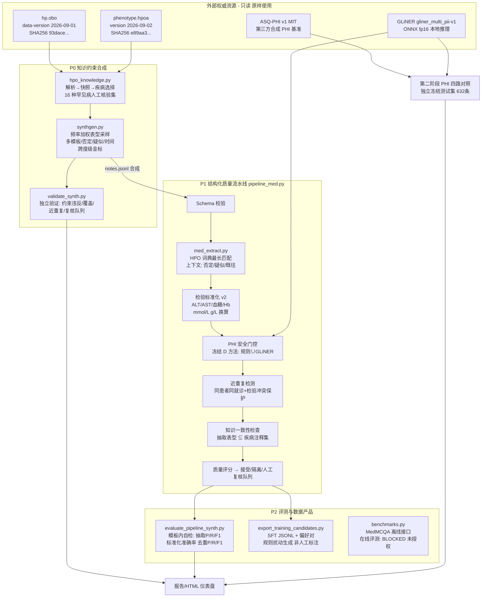

# ClinDataForge 系统架构（截至 2026-10-26）

> 本图与代码结构一一对应。所有外部资源记录版本与 SHA256；真实患者文本入口与正文出口**保持关闭**。

## 总体数据流

## 关键设计决策

| 决策 | 选择 | 理由（真实证据） |
|---|---|---|
| 知识来源 | HPO 本体 + phenotype.hpoa 注释 | 许可允许自由使用；含频率/证据/PMID 引用；版本与哈希可冻结 |
| 合成约束 | 表型 ⊆ 疾病注释集（硬约束） | 独立验证器复核：2,400 条 0 违反 |
| 表型抽取 | 词典最长匹配 + 分句级提示词窗口 | 术语与知识库同源、可审计；medSpaCy 评估后暂缓引入（依赖重、行为等价于透明实现） |
| PHI 门控 | 复用第二阶段冻结的 D 方法（规则∪GLiNER fp16） | 独立测试集召回 0.9042 [ bootstrap 区间不跨 0 ]；int8 量化权重已证明判别力坍缩，禁用 |
| 去重保护 | 同患者+同就诊内比对；检验值冲突即不合并 | 防止把同患者检验更新误判为重复（160 对标注评测） |
| 出口控制 | 真实患者入口/出口关闭；合成数据演示文本输出 | 第二阶段结论：96.55% 无 PHI 硬负样本仍被改动，不能宣称生产级安全 |

## 失败与限制（如实记录）

- GLiNER int8 量化权重表征坍缩（探针最大概率 0.202）→ 全项目改用 fp16；
- spaCy 3.8.x 需锁 preshed==3.0.9 / cymem==2.0.8 / murmurhash==1.0.10，否则 pipeline 加载抛 OverflowError；
- Presidio 不适配中文（zh 召回 0.057）与病历号/医保号；
- 抽取/上下文/标准化指标目前为**模板内自检**，真实临床文本上的独立验证是明确的后续工作；
- SFT/偏好数据仅为候选导出（规则扰动），未执行任何训练，也未获得在线模型评测授权。
